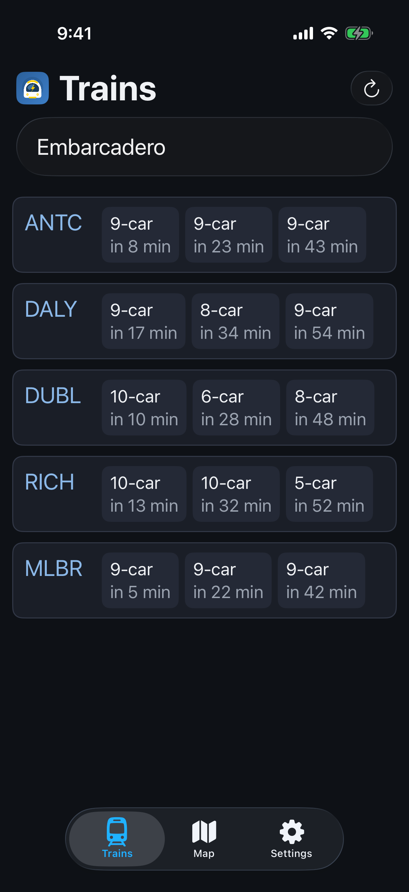
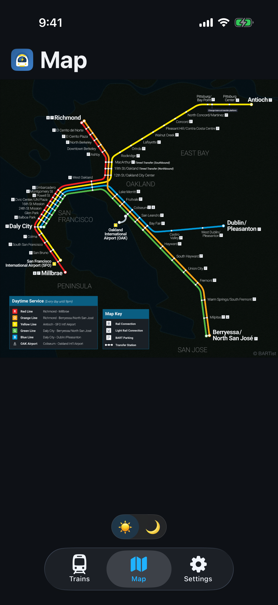
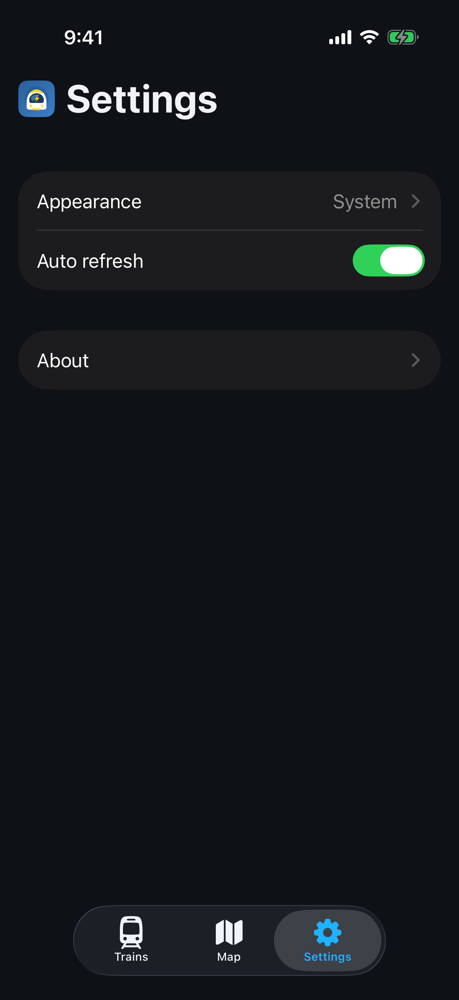

It's a dark day for BARTist. Version 1.2 is on the App Store and it adds the dark mode.

The [native rewrite](../ios-native/) was a great start but had no option to reduce its bright light.

Appearance now follows the mode selected in the system, or you can lock it to Light or Dark in the new Settings tab. The system maps have dark versions too!

The new settings tab also has auto-refresh. Leave it on and the trains list updates every 30 seconds while that tab is open. Turn it off if you'd rather pull to refresh yourself.

There's an About page with the version, App Store / website / privacy links, and the license and map credits.

No ads, accounts, subscriptions, tracking, or analytics. It's open source and the [code is on GitHub](https://github.com/unix1/bartist). Enjoy!
