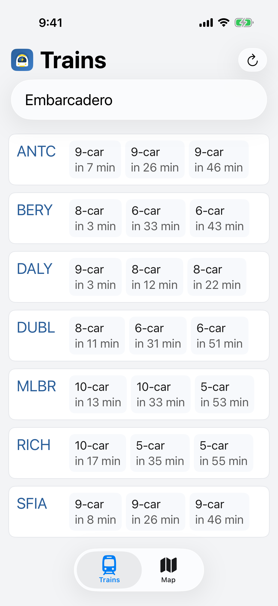
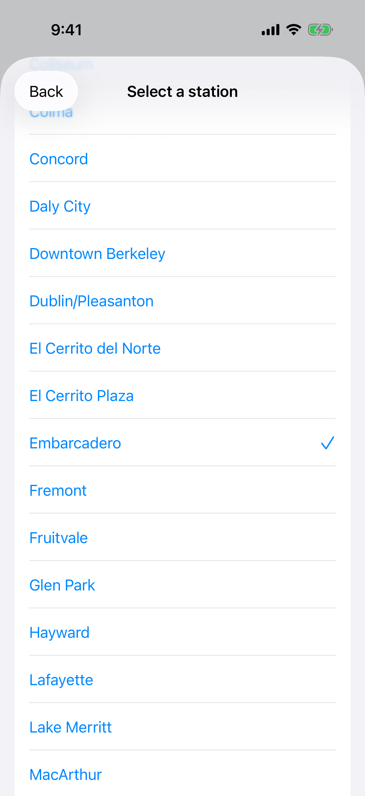
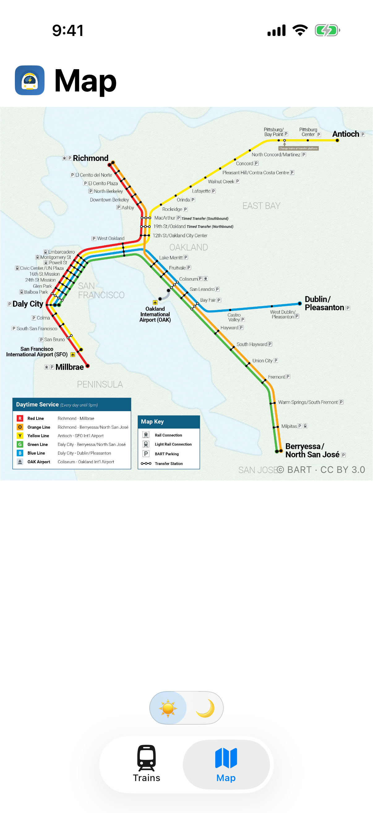

BARTist version 1.1 is now an iOS native app implemented in Swift.

The [first App Store release](../ios-app/) was written using the cross platform [Tauri](https://tauri.app/) framework. It worked well, but fell just a bit short of other native apps - pull to refresh, tabs, pinch to zoom were just a bit clunkier and less fitting. It's time for a real native iOS app. Given that BARTist is simple, so was the rewrite.

The trains tab provides the same dense view of real time train departure information grouped by destination. Note the native tabs and buttons. Also, it now supports the same pull to refresh feel you expect in iOS apps:

Station picker also has a native iOS look and now supports gestures for closing the selection modal:

And the system map, still with the day/night toggle, gives you a buttery smooth pinch to zoom:

The same app, better UX. Still no ads, accounts, subscriptions, tracking, or analytics. It's open source and the [code is on GitHub](https://github.com/unix1/bartist). Enjoy!
