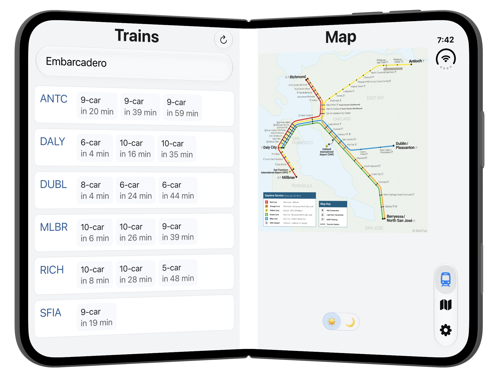
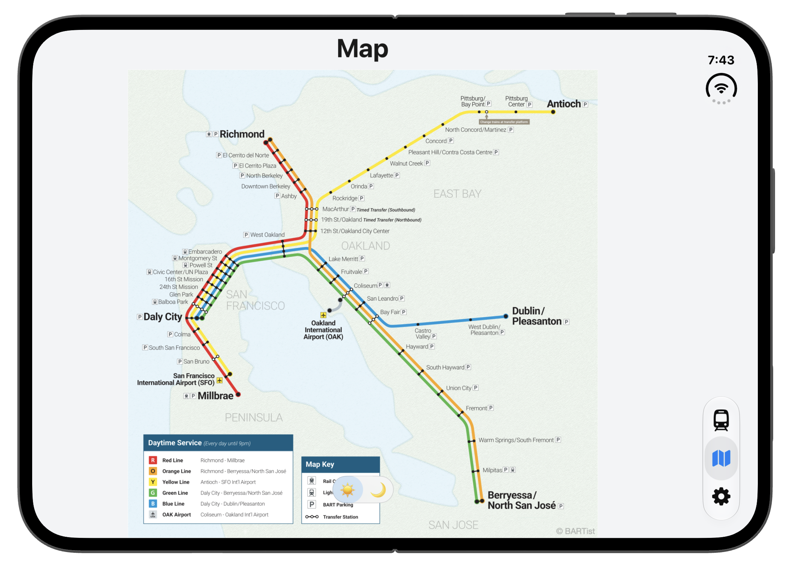
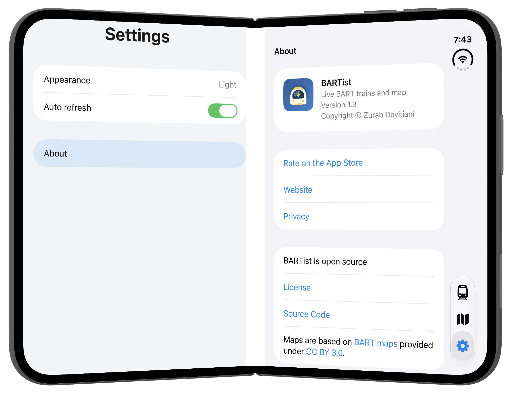

BARTist version 1.3 is seeing double because it now supports iPhone Duo!

In open or book pose, trains and system map sit side by side:

The map tab can now use the entire screen:

Settings are also split naturally:

Of course, the iPhone Duo fully supports the [dark mode](../dark-mode/) as well.

iPhone Duo in folded pose along with other iPhones has the same UX as before.

No ads, accounts, subscriptions, tracking, or analytics. It's open source and the [code is on GitHub](https://github.com/unix1/bartist). Enjoy!
